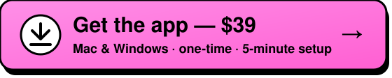

# Autoposter

[](https://github.com/raketbizdev/autoposter/actions/workflows/build.yml)
[](LICENSE)
[](https://github.com/raketbizdev/autoposter/stargazers)


[](https://raket5.gumroad.com/l/autoposter)
[](https://www.buymeacoffee.com/raketbizdev)
[](https://paypal.me/freelancerdad)
[](https://www.youtube.com/watch?v=91bvTaR6GKA)


<p align="center">
  <a href="#easy-install"></a>
  <br>
  
</p>

A local social media post scheduler for Facebook, LinkedIn, X, Threads, Reddit, Instagram and TikTok. You write and schedule posts in a React dashboard. At post time, a local
worker runs **Claude Code on your Claude subscription** with the **Claude in Chrome** extension, and Claude
publishes the post on the website in your signed-in Chrome, the way you would by hand.

- No Anthropic API, API keys or token billing. The worker removes `ANTHROPIC_API_KEY` and similar variables
  from Claude's environment and never uses `--bare`, which would bypass the subscription login.
- No Graph API, Meta, X, LinkedIn, Reddit or TikTok API, and no MCP publishing server. Chrome is the only tool Claude gets.

```
Dashboard (React) → Express API → SQLite → worker (every 60s) → claude -p --chrome → Chrome → the social network
```

## Demo video

[](https://www.youtube.com/watch?v=91bvTaR6GKA)

▶️ Click the picture to watch Autoposter schedule and publish posts.

## Easy install

Don't want to build it yourself? Get the ready-to-install app for **Mac (Apple Silicon and Intel) and Windows**:

<p align="center">
  <a href="https://raket5.gumroad.com/l/autoposter"></a>
</p>

<p align="center">
  
</p>

<!-- Replace "coming soon" with the product link once it's live. -->
| Store | Link |
|---|---|
| **Gumroad** | [Buy on Gumroad](https://raket5.gumroad.com/l/autoposter) |
| **Lemon Squeezy** | coming soon |

$39, one-time payment.

Prefer free? The scheduler is here under the MIT license: see [Run from source](#run-from-source). The desktop app
(menu bar / tray, auto start, installers) is only in the paid version.

| Calendar | Queue | Destinations |
|---|---|---|
|  |  |  |

### Installing

- **Mac:** open the `.dmg` and drag Autoposter to Applications. The app isn't notarized by Apple yet, so macOS blocks
  the first open: go to **System Settings → Privacy & Security** and click **Open Anyway**. If it says the app
  "is damaged", run `xattr -dr com.apple.quarantine /Applications/Autoposter.app` in Terminal, then open it again.
- **Windows:** if SmartScreen says "Windows protected your PC", click **More info → Run anyway** (the installer isn't
  code-signed yet).

Open Autoposter and the **Setup** page walks you through the rest, about 5 minutes, once:

1. **Install Claude Code**: one button runs Anthropic's official installer in a terminal window.
2. **Log in**: sign in with the Claude account that has your Pro or Max plan. No API key.
3. **Connect Chrome**: install the [Claude in Chrome](https://claude.ai/chrome) extension and be signed in to Facebook in that Chrome.
4. **Test post**: post "Only me" to your own profile with **Post now**.
5. **Start the worker.**

Autoposter then lives in the menu bar (Mac) or system tray (Windows). Closing the window keeps it running so
scheduled posts still go out; use **Open at login** in its tray menu to start it with your computer. At post time
the computer must be on and awake (the app keeps it from sleeping while the worker runs) and Chrome must be open.
Your data stays on your computer, in `~/Library/Application Support/Autoposter` or `%APPDATA%\Autoposter`.

## Desktop app vs web app

Autoposter comes two ways. The **desktop app** is the paid, ready-to-install version. The **web app** is the free
version you [run from source](#run-from-source) and open in your browser at `http://127.0.0.1:4317`.

### Same in both

| Feature | Desktop app | Web app |
|---|:---:|:---:|
| Schedule posts to Facebook, LinkedIn, X, Threads, Reddit, Instagram and TikTok | ✅ | ✅ |
| Calendar, Queue and Dashboard | ✅ | ✅ |
| **Write with AI**: posts in any language, with goal, audience, format, style, hook, 36 writing frameworks and word counts | ✅ | ✅ |
| **Write with AI** for the first comment (links, questions, extra details) | ✅ | ✅ |
| **Post preview**: see how a post looks on each platform before it goes out | ✅ | ✅ |
| Edit queued posts (text, photos, time) and destinations | ✅ | ✅ |
| **Delayed** badge that says why a post is late and when it goes | ✅ | ✅ |
| Post now, picking which account posts it | ✅ | ✅ |
| Drag-and-drop photos and video | ✅ | ✅ |

### Only in the desktop app

| Feature | Desktop app | Web app |
|---|:---:|:---:|
| **All your accounts logged in at once**: each account logs in once inside Autoposter and stays logged in, with no switching | ✅ | One account at a time, in your Chrome |
| **Posts in the background**: hidden windows, so you keep using your computer | ✅ | Posts in your Chrome, where you can see it working |
| **Create image with AI**: Claude designs post graphics, with or without your own photos (square, 4:5, story, landscape) | ✅ | Not yet |
| **Your Facebook Pages listed automatically** under each account, so you can post in groups as a Page | ✅ | — |
| Real profile pictures for every account and Page | ✅ | — |
| Built-in browser: links open inside Autoposter, logged in as the right account | ✅ | Opens in Chrome |
| Checks posts waiting for group approval in the background | ✅ | Through Chrome |
| **Big videos for TikTok and Reels**: up to 4 GB per post | ✅ | 10 MB (the Chrome extension's upload limit) |
| Menu bar / tray app, starts with your computer, keeps it awake at post time | ✅ | — |
| One-click installer for Mac and Windows, and automatic updates | ✅ | — |

Both use your own Claude subscription (Pro or Max). Neither needs an API key.

<p align="center">
  <a href="https://raket5.gumroad.com/l/autoposter"></a>
</p>

## Run from source

Node 24+ and Claude Code logged in with your Claude subscription (`claude auth status` shows `"authMethod": "claude.ai"`).

```bash
npm install
npm run build && npm start          # dashboard at http://127.0.0.1:4317
npm run worker                      # in another terminal
bash scripts/install-launchd.sh     # macOS only: run server + worker at every login and restart them if they die
```

## Use it

1. **Settings:** if more than one Chrome is connected to Claude, set **Facebook account** to the address
   `facebook.com/me` lands on, so only that account posts. Edit how Claude describes you when a group asks
   membership questions.
2. **Destinations:** add your profile (`https://www.facebook.com/me` works), Pages you can post as, and groups you can post in.
3. **Compose:** write text, attach photos or one video, tick destinations, pick a time.
4. **Queue:** watch each post's status and read Claude's report for any run.

## Platforms

| Platform | Destinations | Notes |
|---|---|---|
| Facebook | Profile, Pages, groups | Joins groups first if needed and answers membership questions. Each group can post as you or as one of your Pages (**Post as** in Destinations). |
| LinkedIn | Profile, company Pages, groups | Page posts go out as the Page. |
| X | Profile | Long text fails unless your account allows it; Claude never shortens it. Up to 4 photos. |
| Threads | Profile | |
| Reddit | Your profile, subreddits | The first line of the post is the title. Claude picks a flair when one is required. |
| Instagram | Profile | Needs a photo or a video. |
| TikTok | Profile | Needs a video. |

Chrome must be signed in to each account you post to. The group gap applies between group posts on the same platform.

## Statuses

| Status | Meaning |
|---|---|
| Queued | Waiting for its time, the group gap or the daily cap |
| Posting… | Claude is working in Chrome |
| Posted | Claude clicked Post and then saw the post live on the profile, Page or group. If it can't see it live, the post goes to "Needs check" instead. |
| Pending approval | Posted to a group that needs admin approval |
| Failed | Claude stopped **before** clicking Post (login wall, checkpoint, no permission). Retried once automatically. |
| Needs check | Claude may have clicked Post but the result is unclear (crash, timeout, unreadable report). **Never retried automatically.** Check Facebook, then choose "It posted" or "It didn't post — retry now". |

## Limits and risks

- **Facebook's terms restrict automated access.** Posting the same content to many groups looks like spam.
  The daily cap (default 10) and group gap (default 20 min) reduce the risk but don't remove it.
- **Subscription usage.** Each post is a full Claude Code browser session. The first test used about
  25 steps and roughly 730k tokens (mostly cached) on Sonnet, in about 2.5 minutes. That counts against your
  plan's usage limits. When a limit is hit, the worker pauses for 1 hour and requeues the post.
- **Check the terms yourself.** Make sure that running Claude Code unattended on a schedule is allowed by
  your current Claude subscription terms.
- **Media size per post: 10 MB in the web app, 4 GB in the desktop app.** The web app uploads through the Claude in Chrome
  extension, whose file upload stops at 10 MB, so most phone videos won't fit there. The desktop app attaches files in its
  own window, so full TikTok videos and Reels fit.
- If the computer sleeps, Chrome is closed or Facebook logs you out, posts run late or fail and the dashboard shows it.
  CAPTCHAs and security checks are never bypassed; the post fails and you handle it.
- One Facebook login (the one in Chrome). Pages are posted to by switching into the Page.

## Development

```bash
npm test        # node:test, uses a fake claude binary — no Facebook, no usage
npm run dev     # Vite dev server on :5173, proxying to npm start on :4317
```

Data lives in `data/` (SQLite), `media/` (uploads), `jobs/` (per-run copies) and `logs/` (raw Claude output per run).

## Support the project

Autoposter's scheduler is free and open source. If it saves you time, you can help keep it going:

- **Buy the desktop app** on [Gumroad](https://raket5.gumroad.com/l/autoposter). It's the easiest install, and every sale funds development.
- **Star the repo** ⭐ so more people find it.
- **Donate** any amount:

  [](https://www.buymeacoffee.com/raketbizdev)
  [](https://paypal.me/freelancerdad)

  **GCash / InstaPay (Philippines):** scan with GCash, Maya or any bank app.

  

## License

[MIT](LICENSE). Not affiliated with, endorsed by or sponsored by Meta or Anthropic. You are responsible for
following Facebook's terms and your Claude plan's terms when you use it.
